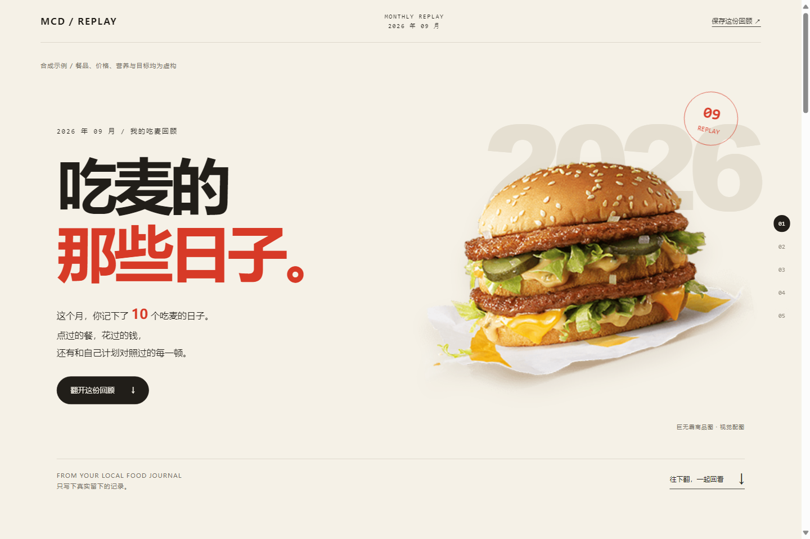
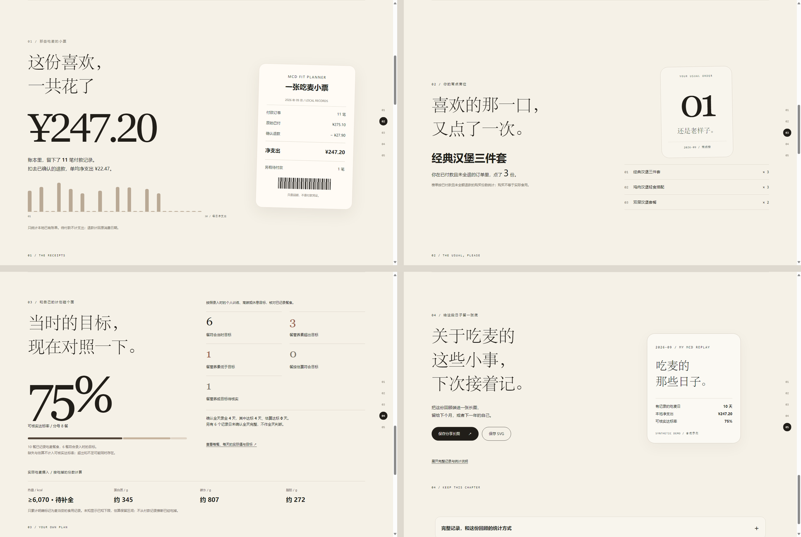
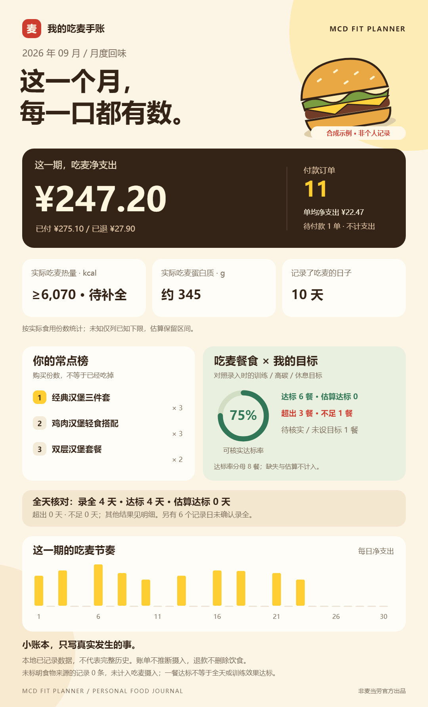
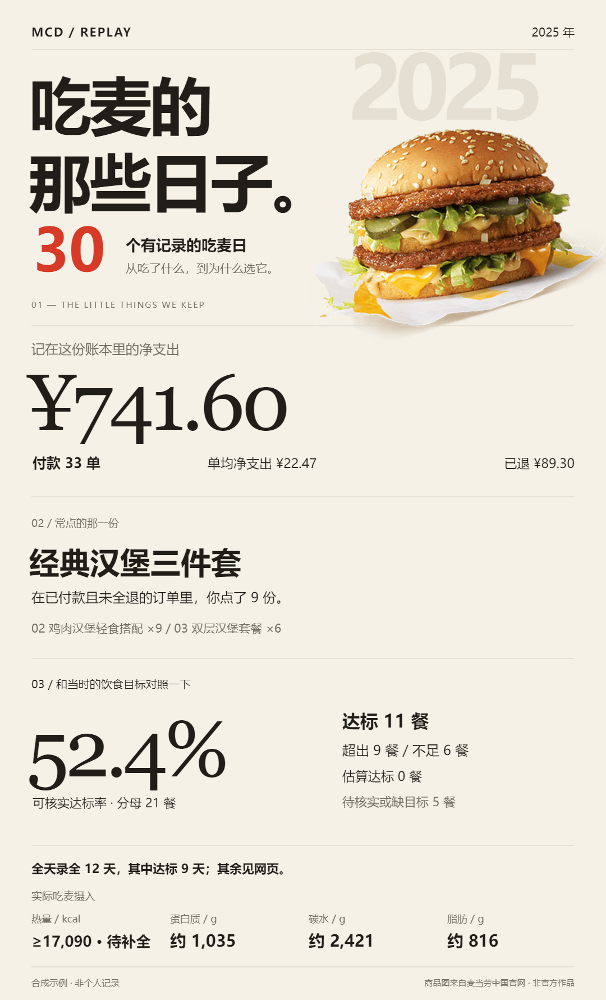

<div align="center">

**MCD FIT PLANNER · 吃麦，也有自己的节奏**

# 今天吃麦，刚好合拍。

提前记住你的训练计划，点餐时比较套餐，月末把吃过的日子整理成手账。

[](https://github.com/tomsbin/mcd-fit-planner/releases/latest)
[](#一分钟离线试玩)
[](LICENSE)

**[下载技能](https://github.com/tomsbin/mcd-fit-planner/releases/latest) · [开始使用](#安装到-workbuddy) · [吃麦手账](#月末年末吃麦手账) · [接入其他-agent](#codex-与-deepseek-agent)**

WorkBuddy / Codex / 支持 MCP 与本地 Python 的 DeepSeek Agent



<sub>麦当劳饮食计划助手 · 基于麦当劳中国官方 MCP 的非官方 Agent Skill · 预览均为合成数据</sub>

</div>

## 从今天吃什么，到这一年吃得怎么样

| 先记住你 | 帮你选一餐 | 留下吃麦手账 |
| :--- | :--- | :--- |
| 保存训练、高碳与休息日目标，临时休息顺延计划。 | 默认优先比较套餐，同时看实际应付与整餐营养。 | 记录实际摄入和消费，生成月度、年度网页与分享长图。 |

> “今天训练日，保留我想吃的汉堡，看看套餐怎么搭更划算，也更接近我的目标。”

当前版本 **0.8.4**。提前录入已有饮食目标后，日常点餐即可沿用计划；每次下单前展示价格、组成和营养差异，由你确认。

<details>
<summary><strong>展开完整功能：套餐、营养、计划与账本</strong></summary>


| 场景 | 行为 |
|---|---|
| 预先安排训练日、高碳日和休息日 | 循环长度自定义，每种日类型保存每日和早中晚目标、预算 |
| 临时休息一天 | 暂停循环并顺延后续安排；计划内休息正常推进 |
| 点汉堡、薯条和饮料 | 从当店菜单自动发现相关套餐，核对真实组件，再查询应付总价 |
| 已指定主食或份数 | 保留要求；替换主食、改变份量须展示差异并取得确认 |
| 换更省或更适合目标的搭配 | 同时展示价格、热量及三大营养素变化；同价改善也可推荐 |
| 官方营养缺失 | Agent 主动查对应中国规格的公开来源，保留证据或估算区间；未知不当零 |
| 薯条只吃半份 | 按实际摄入记录，订单购买份数与食用份数分开 |
| 查询吃麦支出 | 合并本地账单，区分待支付、已支付和退款，支持月年统计及 CSV |
| 月末／年末吃货总结 | 生成漂亮的离线网页、SVG 和 PNG 长图：净支出、常点榜、消费节奏与实际营养 |
| 回看健身饮食目标 | 按历史训练／高碳／休息目标，区分达标、估算、超出、不足与未知；全天录全后单独核对 |

套餐发现默认覆盖相关商品与限额内超值搭配。缺少相关套餐详情或可行套餐未核价时，不能进入下单预览；不能只勾“已检查”就放行。零元应付先列为待核实，不自动当成免费订单。

</details>

## 一分钟离线试玩

**0.8.4：比较结果更直观。** 原单应付、保留同样餐品能省多少、换餐品能省多少分别展示，并保留整餐热量与三大营养素、变化及未知项。优惠候选未比完时明确返回未完成，补查后才进入下单确认；多券拆单另行确认，不自动增加订单。[查看合成比价摘要](examples/comparison-summary.demo.json)。比价呈现参考 [mai-suanpan](https://github.com/W313997791/mai-suanpan)，计算与校验由本项目独立实现。

Python **3.11+**，仅使用标准库，不需要 Token 或安装依赖。

```bash
git clone https://github.com/tomsbin/mcd-fit-planner.git
cd mcd-fit-planner
python -X utf8 demo.py
```

演示使用合成餐品、价格、营养与目标，数据库在独立临时目录中，结束后清理；不会读取账户或产生真实订单。

## 安装到 WorkBuddy

1. 在 [Releases](https://github.com/tomsbin/mcd-fit-planner/releases) 下载 `mcd-fit-planner-workbuddy.zip`。
2. WorkBuddy「专家·技能·连接器」→「技能」→「添加技能」→「上传技能」，导入并启用。
3. 在 [麦当劳 MCP 平台](https://open.mcd.cn/mcp) 取得自己的 Token，在本机连接器接入 `https://mcp.mcd.cn`。
4. 先查询营养和菜单验证连接，再录入自己的已有计划、默认门店与预算。

[配置示例](mcp-config.example.json)只包含环境变量占位符 `${MCD_MCP_TOKEN}`。由支持变量展开的宿主在本机读取；宿主不支持时，在其本机连接器界面填写。不要提交包含真实 Token 的配置。

其他宿主可使用通用包 `mcd-fit-planner-skill.zip`，或直接读取 [SKILL.md](skill/mcd-fit-planner/SKILL.md)。详细步骤见 [WorkBuddy 安装说明](skill/mcd-fit-planner/references/workbuddy-setup.md)。

## Codex 与 DeepSeek Agent

| 环境 | 接入方式 |
|---|---|
| Codex app／CLI／IDE | 将通用包的技能文件夹放入个人 `~/.agents/skills/` 或项目 `.agents/skills/`，合并 [MCP TOML 示例](examples/codex-config.example.toml) |
| DeepSeek 模型的 Agent | 由宿主加载 SKILL.md、桥接官方 MCP、执行本地 Python；普通聊天窗口需先具备这些能力 |
| 不接模型，仅做统计 | 直接运行本地脚本生成总结，无需模型 API Key 或 MCP Token |

[完整接入与只读验收](skill/mcd-fit-planner/references/hosts.md)包含官方文档来源。当前已验证本地脚本和图片渲染，以及 WorkBuddy 官方 MCP 查询；DeepSeek API 端到端联调尚未验证。不会因安装技能替换宿主已有配置。

## 月末／年末吃麦手账

生成分章节回顾网页和 **1080×1780 分享长图**。从封面、消费小票、常点席位，到饮食目标和保存分享，一屏讲一件事；整套采用统一米白纸色、灰褐图表、衬线排版与麦当劳中国官网商品配图。网页支持章节导航、键盘翻页、展开每日明细和 PNG／SVG 下载；模板与商品图均内嵌，可离线打开，配图来源见[第三方说明](skill/mcd-fit-planner/references/third-party-notices.md)。



[手机版封面](examples/recaps/mobile-cover.png) · 以下是可导出的月度／年度分享长图：

<details>
<summary>查看月度与年度分享长图</summary>

<a href="examples/recaps/month.png"></a>
<a href="examples/recaps/year.png"></a>

</details>

上图**全部为合成演示数据**，不含个人账本。下载 [月度网页](examples/recaps/month.html)／[年度网页](examples/recaps/year.html)后用浏览器打开；GitHub 文件页不直接运行 HTML。

```powershell
# 离线演示：不读取真实账户或账本
python skill/mcd-fit-planner/scripts/period_recap.py --demo --period 2026-09 --output data/month.html --png data/month.png

# 真实统计：只读现有账本，路径换成自己的固定位置
python skill/mcd-fit-planner/scripts/period_recap.py --db "D:/my-mcd-data/planner.sqlite3" --period 2025 --output "D:/my-mcd-data/year.html" --svg "D:/my-mcd-data/year.svg" --png "D:/my-mcd-data/year.png"
```

Python 仅使用标准库；命令行 PNG 需要本机 Edge／Chrome，没有时可打开 HTML 下载图片。真实统计按实际食用份数计算，购买不等于摄入；目标使用录入时的快照，修改计划不追溯改判。估算和缺失不算可核实达标，一餐结果不等于全天结果，全天需用户确认吃喝已录全。高碳日检查碳水目标，不把低热量统一当作最好。详见 [总结图与统计口径](skill/mcd-fit-planner/references/period-recap.md)。

## 使用示例

以下是功能示例，不是个人饮食处方；实际目标由使用者已有计划提供。

> 保存我的训练 A、高碳训练 B、休息、训练 C 循环；每天和各餐按我提供的目标与预算执行。

> 推荐今天午餐，保留指定汉堡，优先比较套餐。这次先不下单。

> 今天临时休息，后续训练顺延。

> 这个搭配换饮料能省多少？热量、蛋白质、碳水和脂肪怎么变？

> 薯条只吃了一半，记录实际摄入。这个月和今年吃麦当劳花了多少？

> 生成上个月的吃麦手账，给我网页和分享长图。按我当时的训练计划看看哪些餐达标、哪些超了或蛋白质没吃够。

整餐报告列出营养点值、估算区间或已知下限，注明来源；对照已录入的当日训练模板，说明符合、超出或不确定。成年男女群体参考会注明年龄、活动水平和标准版本，不替代个人目标。

账本保存在**技能目录之外的固定本机目录**，每次操作统一传 `--db`。订单未付款不记为已支出，生成订单不记为已经食用；近期订单接口不代表完整年度历史。

## 工作流程


本地 Python 负责计算与校验，官方 MCP 调用由宿主 Agent 完成。付款由用户在官方渠道完成。完整工具和字段流程见 [MCP_INTEGRATION.md](MCP_INTEGRATION.md)。

## 验证与构建

```bash
python -X utf8 -m unittest discover -s tests
python -X utf8 build.py
```

当前 **239 项离线测试**覆盖循环顺延、营养区间、套餐自动发现及优先级、排除套餐变体、用券参数、零元报价隔离、预览确认、账本和导出，以及月年总结、历史目标、全天确认、半份／估算／漏记、退款和只读输出保护。另已用真实浏览器验证网页筛选与 SVG／PNG 下载，图片尺寸为 1080×1780。测试中的优惠价格与券码为合成数据；公开食品捕获样例不含账户信息，不能代表当前库存或价格。

已使用官方 MCP 完成真实营养、门店菜单、详情和计价查询。真实付款、券核销，以及外送、团餐和预约的线上交易未作为完成验证；相关参数链路有离线测试。价格结论只覆盖实际查询的候选，不保证全菜单、全渠道最低；小程序可见活动可能与 MCP 不同。

构建输出：

- `dist/mcd-fit-planner-workbuddy.zip`：WorkBuddy 导入包。
- `dist/mcd-fit-planner-skill.zip`：通用技能包。

## 文档与许可

- [本地数据和命令](skill/mcd-fit-planner/references/local-data.md)
- [菜单、套餐与组件](skill/mcd-fit-planner/references/catalog-builder.md)
- [营养来源与报告](skill/mcd-fit-planner/references/nutrition-report.md)
- [MCP 编排及订单确认](skill/mcd-fit-planner/references/mcp-flow.md)
- [Codex 与 DeepSeek Agent 接入](skill/mcd-fit-planner/references/hosts.md)
- [月年总结图与统计口径](skill/mcd-fit-planner/references/period-recap.md)

项目代码采用 [MIT 许可](LICENSE)。商品图片版权归原权利人所有，不包含在代码 MIT 许可中。优惠门槛解析改编自 MIT 授权的 `mcd-coupon-strategist`，配图来源、修改说明及完整许可见 [第三方声明](skill/mcd-fit-planner/references/third-party-notices.md)。

本项目为非官方参赛作品，与麦当劳不存在官方产品或背书关系。规则见 [官方活动仓库](https://github.com/M-China/mcd-developer-innovation-challenge)，参赛声明使用官方原文。
